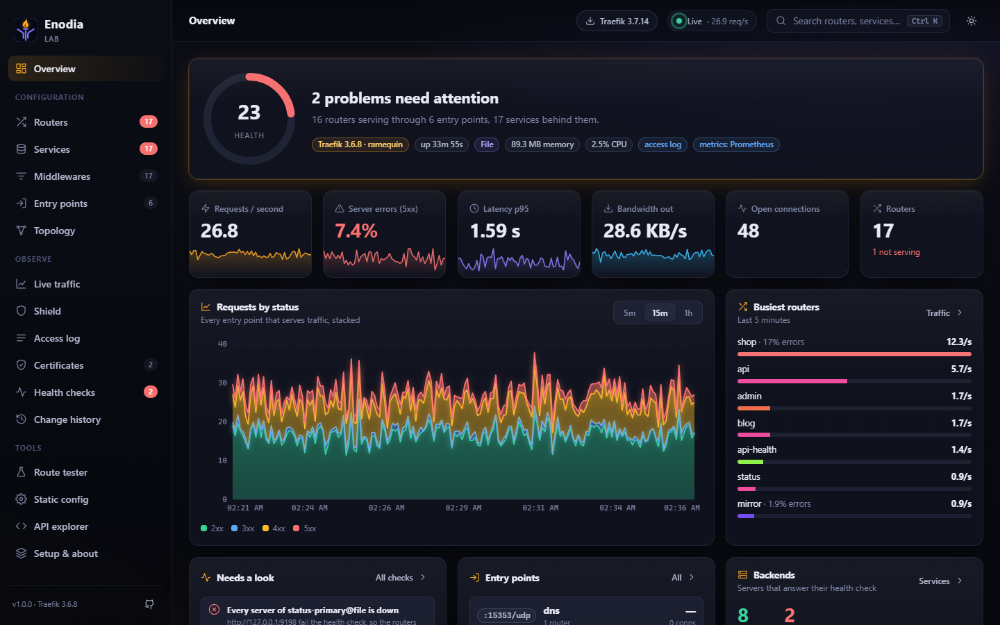
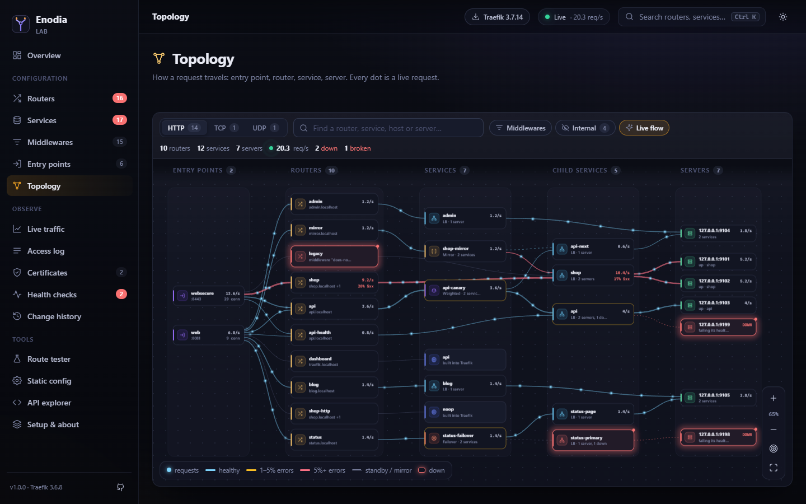
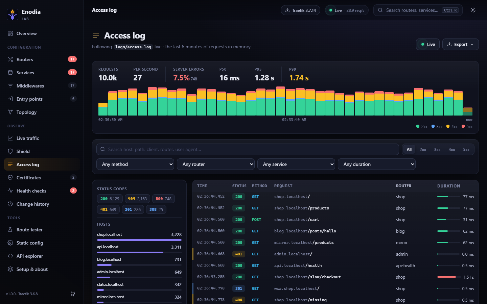
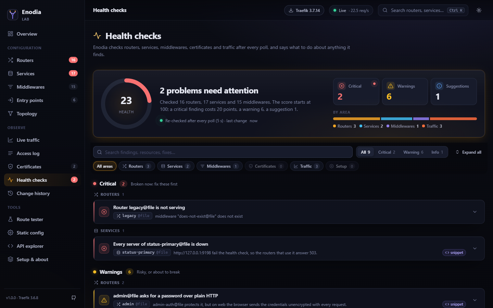

<p align="center">
  
</p>

<h1 align="center">Enodia</h1>

<p align="center">
  A dashboard for Traefik: every route, live traffic, access logs, certificates and plain-language health checks.<br>
  One small container, no database, read-only towards Traefik.
</p>

<p align="center">
  <a href="#install">Install</a> ·
  <a href="#features">Features</a> ·
  <a href="#configuration">Configuration</a> ·
  <a href="#updating">Updating</a> ·
  <a href="#security">Security</a> ·
  <a href="#development">Development</a>
</p>



Traefik's own dashboard shows what is configured. Enodia shows that too, and also what is happening and what is wrong: which router takes a request, which service is down, which certificate expires next week, which middleware nobody uses, what changed since yesterday and what the last thousand requests looked like.

It reads Traefik's API, its Prometheus metrics and its access log. It never changes Traefik.

## Install

On the machine that runs Traefik:

```sh
curl -fsSL https://raw.githubusercontent.com/georgemos940/enodia-traefik/main/install.sh | bash
```

The installer asks Traefik itself what it is: version, entry points, certificate resolvers, where the metrics and the access log are. It then picks the setup that fits:

| What it finds | What it does |
|---|---|
| Traefik in Docker (configured by flags, environment, `traefik.yml` or `traefik.toml`) | Runs Enodia on Traefik's network, shares the access log read-only, routes your domain with labels |
| Traefik as a Docker Swarm service | Deploys Enodia as a stack on Traefik's overlay network |
| Traefik on the host (binary, systemd) or somewhere else | Runs Enodia on the host network and writes a file-provider route for your domain |
| A Traefik that reads only files, not Docker labels | Same, with a route file to drop into its directory |
| No Traefik at all | Sets up Traefik and Enodia together, with Let's Encrypt when you give a domain |
| No Docker, but Node.js 20+ | Installs Enodia as a systemd service |

It asks three things (a domain, a password, a name) and has an answer for each if you just press Enter. To skip the questions:

```sh
curl -fsSL https://raw.githubusercontent.com/georgemos940/enodia-traefik/main/install.sh \
  | bash -s -- --yes --domain=traefik.example.com --password=change-me
```

All options: `--dir`, `--domain`, `--password`, `--port`, `--version`, `--email`, `--api`, `--mode` (`docker`, `swarm`, `host`, `stack`, `node`) and `--yes`. Run `bash install.sh --help` for details.

### By hand

<details>
<summary>Docker Compose, next to a Traefik you already run</summary>

See [`examples/compose-existing-traefik.yml`](examples/compose-existing-traefik.yml). Traefik needs its API on the internal port:

```yaml
# traefik.yml, or the flags in examples/traefik.yml
api:
  insecure: true          # served on :8080 inside the network; do not publish it
metrics:
  prometheus:
    addRoutersLabels: true
accessLog:
  filePath: /logs/access.log
  format: json
```

</details>

<details>
<summary>Docker Compose, Traefik and Enodia from scratch</summary>

[`examples/compose-with-traefik.yml`](examples/compose-with-traefik.yml)

</details>

<details>
<summary>docker run</summary>

```sh
docker run -d --name enodia --network <traefik's network> \
  -e TRAEFIK_API_URL=http://traefik:8080 \
  -e ENODIA_PASSWORD=change-me \
  -v enodia-data:/data \
  -p 127.0.0.1:3000:3000 \
  ghcr.io/georgemos940/enodia:latest
```

</details>

<details>
<summary>Kubernetes (Helm chart or k3s)</summary>

[`examples/kubernetes.yaml`](examples/kubernetes.yaml): a Service in front of Traefik's API and metrics ports, the Enodia Deployment and an IngressRoute.

</details>

<details>
<summary>Docker Swarm</summary>

[`examples/swarm-stack.yml`](examples/swarm-stack.yml)

</details>

<details>
<summary>Without Docker</summary>

Node.js 20 or newer, no dependencies to install:

```sh
git clone https://github.com/georgemos940/enodia-traefik && cd enodia-traefik
TRAEFIK_API_URL=http://127.0.0.1:8080 ENODIA_PASSWORD=change-me npm start
```

A systemd unit: [`examples/enodia.service`](examples/enodia.service).

</details>

<details>
<summary>A route for Traefik's file provider</summary>

[`examples/file-provider-route.yml`](examples/file-provider-route.yml)

</details>

Images are published for `linux/amd64`, `linux/arm64`, `linux/arm/v7` and `linux/arm/v6`, so a Raspberry Pi works too. Enodia works with Traefik v2.11 and v3.

## Features

**See everything Traefik serves**
- Routers, services and middlewares for HTTP, TCP and UDP, with search, filters and a details drawer for each.
- Rules shown as readable conditions, with every host and path a router answers.
- Entry points with their ports, TLS, redirections and the routers on each.
- A topology map from entry points through routers and middlewares to services and their servers.

**See what is happening**
- Live traffic per entry point, router and service: requests per second, status classes, latency p50/p95/p99, bandwidth, open connections.
- An access log explorer: filter by status, method, router, client or path, follow it live, and see the top clients, paths and slowest requests.
- Certificates with their domains, issuer and days left.

**Know what is wrong**
- Health checks that read like a colleague's review: routers that point at missing services, certificate resolvers that do not exist, services with every server down, HTTP twins without a redirect, unused middlewares, the API exposed without auth, error rates and slow routers. Each with the fix.
- A health score on the overview.
- Change history: every router, service and middleware that appeared, changed or vanished, with a before and after.
- Optional webhook (Discord, Slack-compatible or any JSON endpoint) for new critical findings.

**Tools**
- Route tester: type a URL, see which router takes it and why the others do not.
- The static configuration Traefik reports, and a raw API explorer.

**Made to be used every day**
- Ctrl K searches everything; `g` then a letter jumps to a page (`g r` routers, `g t` traffic, `g l` logs, `?` lists them all).
- Dark and light themes, works on a phone, respects reduced motion.
- Updates arrive over a single live connection; nothing reloads.
- Tells you when a new Enodia or Traefik release is out, with the command to update.

| | |
|---|---|
|  |  |
|  |  |

## Configuration

Everything is an environment variable. The installer writes them to `.env` in its directory. Any of them can also be read from a file with a `_FILE` suffix, for Docker and Kubernetes secrets (`ENODIA_PASSWORD_FILE=/run/secrets/enodia`).

| Variable | Default | |
|---|---|---|
| `TRAEFIK_API_URL` | `http://traefik:8080` | Traefik's API |
| `TRAEFIK_API_USERNAME`, `TRAEFIK_API_PASSWORD` | | When the API sits behind basic auth |
| `TRAEFIK_API_HEADERS` | | Extra headers as JSON, e.g. `{"X-Token":"..."}` |
| `TRAEFIK_INSECURE_TLS` | `false` | Accept a self-signed certificate on the API |
| `TRAEFIK_TIMEOUT_MS` | `5000` | |
| `TRAEFIK_METRICS_URL` | found on its own | Prometheus endpoint; `off` turns live traffic off |
| `TRAEFIK_ACCESS_LOG` | found on its own | Path of the access log inside Enodia; `off` turns the explorer off |
| `ENODIA_PASSWORD` | | Password for the login page |
| `ENODIA_TRUST_HEADER` | | Trust a user header from a forward-auth proxy instead, e.g. `Remote-User` |
| `ENODIA_SECRET` | random per start | Signs sessions; set it to keep people logged in across restarts |
| `ENODIA_SESSION_HOURS` | `12` | |
| `ENODIA_INSTANCE_NAME` | | Shown in the header, handy with several Traefiks |
| `ENODIA_WEBHOOK_URL` | | Called for new critical findings |
| `ENODIA_CERT_WARN_DAYS`, `ENODIA_CERT_CRITICAL_DAYS` | `21`, `7` | |
| `ENODIA_POLL_SECONDS` | `5` | How often Traefik is read |
| `ENODIA_HISTORY_MINUTES` | `60` | Traffic history kept in memory |
| `ENODIA_LOG_KEEP` | `10000` | Access log lines kept in memory |
| `ENODIA_DATA_DIR` | `/data` in the image | Change history across restarts |
| `ENODIA_BASE_PATH` | | Serve under a path, e.g. `/enodia` |
| `ENODIA_UPDATE_CHECK` | `true` | Look for new releases on GitHub every 6 hours |
| `PORT`, `HOST` | `3000`, `0.0.0.0` | |

When metrics and the access log are left unset, Enodia finds them: metrics on the API's address or on the entry point Traefik reports for Prometheus, the access log at `/traefik-logs/access.log`, `/logs/access.log` or `/var/log/traefik/access.log`, wherever it is mounted.

## Updating

Enodia checks GitHub for new releases and shows a notice in the top bar with the release notes and the exact command for how you installed it. Installed with the script:

```sh
curl -fsSL https://raw.githubusercontent.com/georgemos940/enodia-traefik/main/install.sh | bash -s -- update
```

It keeps your settings and history, waits for the new version to report healthy, and prints the old and new version. Pin a version with `--version=1.2.0`. With Compose: `docker compose pull enodia && docker compose up -d enodia`. On Kubernetes: `kubectl rollout restart deployment/enodia`.

To remove it: `... | bash -s -- uninstall`, or `uninstall --purge` to delete its settings and history too. A Traefik the installer set up keeps running.

## Security

- Enodia only reads from Traefik. It has no way to change routes, and it does not need the Docker socket.
- Put a password on it (`ENODIA_PASSWORD`) or a forward-auth proxy in front (`ENODIA_TRUST_HEADER`). The installer always sets a password.
- Logins are rate limited; sessions are signed, HTTP-only, SameSite cookies.
- A strict Content Security Policy: no inline scripts, no third-party requests from the browser.
- Secrets in Traefik's configuration (basic-auth users, tokens, keys) are masked on screen.
- Traefik's API with `api.insecure=true` is meant for the internal network. Do not publish port 8080; the installer never does.

## Development

```sh
npm run lab
```

The lab downloads Traefik (checksum verified), starts it with a set of demo backends, generates traffic and serves Enodia on http://localhost:3000, so every page has something to show. `npm test` runs the tests. There are no dependencies.

`lab/v2/` holds the same setup for Traefik v2.

## The name

Enodia (Ἐνοδία, "of the road") is the Greek goddess of roads, crossroads and gateways, who stood at the entrance of houses and cities and lit the way with torches. A reverse proxy is a crossroads for requests; Enodia watches it.

## License

MIT
